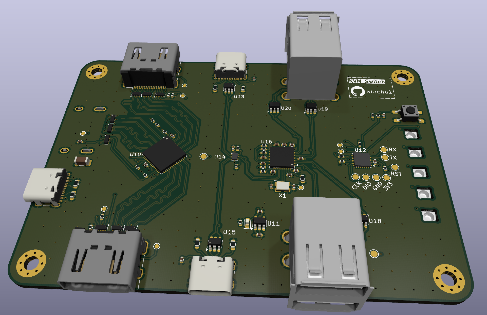
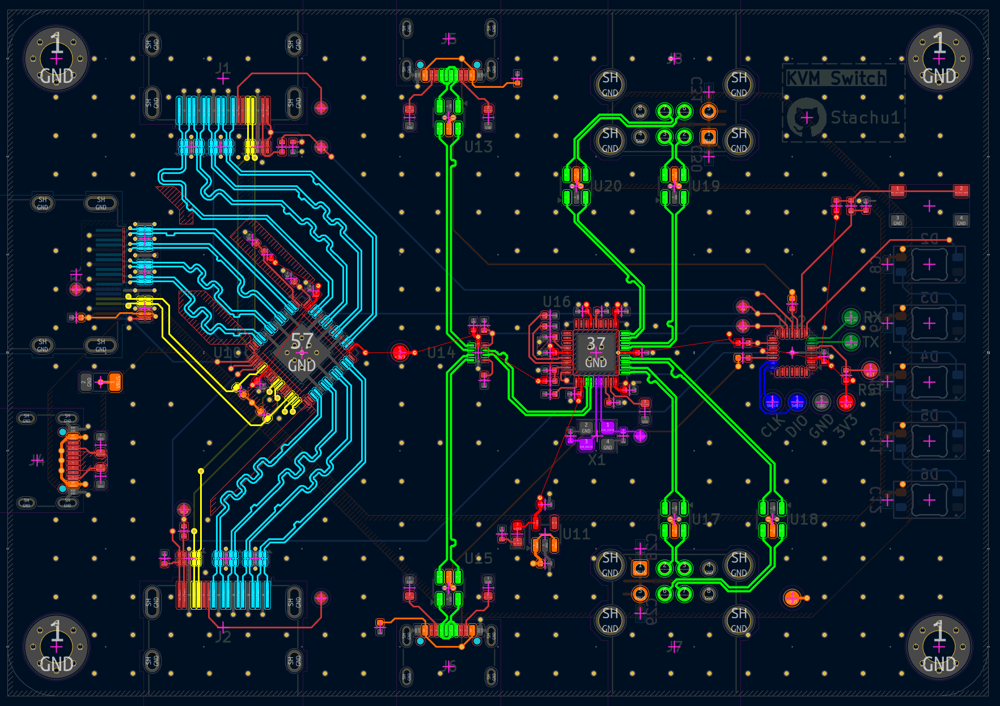

# KVM Switch

A two-computer HDMI + USB KVM switch designed in KiCad.

This is a personal project with the goal of learning more about digital high-speed PCB design: controlled-impedance differential pairs, length matching, layer stackup and keeping signal integrity in check on HDMI and USB lines.

## PCB






## Assembled device


## Overview

- Switches one HDMI display between two HDMI sources (TI HD3SS215)
- Shares USB peripherals between two hosts through a USB 2.0 hub (Microchip USB2514B) and a USB host selector (TI TS3USB221A)
- Two USB-C upstream ports for the hosts, stacked USB-A ports for peripherals
- STM32C031 microcontroller handles input selection via a push button, with a bar of five addressable RGB LEDs (SK6812MINI-E)
- Detects each host's HDMI 5V and USB-C VBUS, so the board knows when a computer is connected or disconnected
- ESD protection on all external HDMI and USB connectors
- Powered over USB-C
- 4-layer PCB

## Firmware

Bare-metal C on the CMSIS headers, about 7.4 KB of the STM32C031's 32 KB flash. See
[firmware/README.md](firmware/README.md) for build, flashing and details.

- **Button:** a short press switches HDMI and USB to the other computer. A long press steps the LED brightness.
- **LEDs:** dark at rest. They only light for events, and each effect fades out:
  - on a switch, a light runs from the old computer's end of the bar to the new one's
  - when a computer is plugged in, its end of the bar pulses
- **Colors:** host A is orange, host B is purple.
- **Auto-switch:** if the active computer disconnects and the other is connected, the board switches to it.
- **Clean USB handover:** the hub disconnects from the old computer before the USB mux moves, so both computers see a normal unplug and plug.
- **UART console** on the TX/RX test points (115200 8N1): status, manual switching, and settings for brightness, colors, auto-switch and animation. Settings are saved in flash.

## Repository layout

```
hardware/   KiCad project (schematics, PCB, custom library, BOM)
firmware/   Bare-metal firmware for the STM32C031
images/     Pictures used in this README
```

## Tools

- KiCad 10
- Arm GNU toolchain and make (the copies bundled with STM32CubeIDE work), STM32CubeProgrammer for flashing
